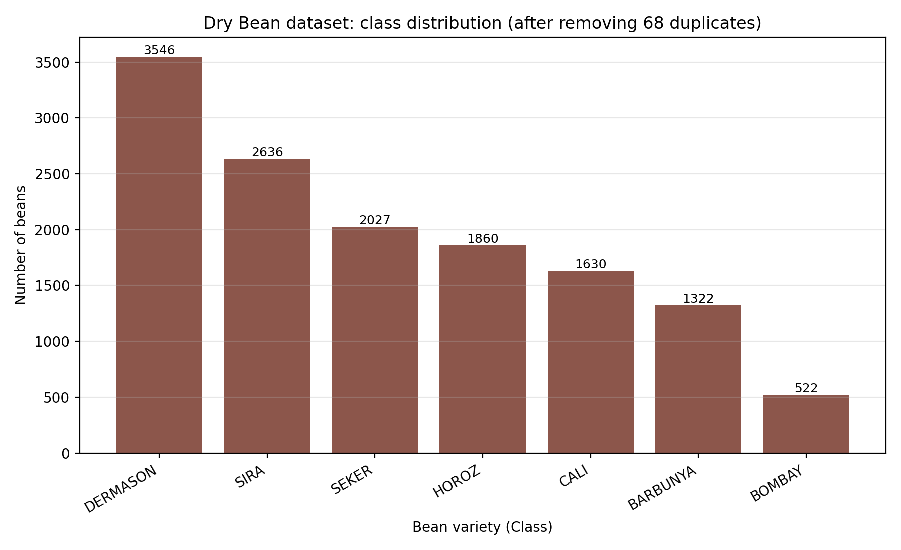

## a. Problem Statement
The problem is about differentiation among various types of dry beans. In this problem, there are seven different varieties of dry beans (Seker, Barbunya, Bombay, Cali, Dermason, Horoz, Sira) 
which look quite similar. Assorting them in different categories takes time and also lacks consistency, is prone to errors. 

So this project is about prediction of a variety of bean from set of 16 measurements of shape and size extracted by computer-vision system which extracts from a single grain image.
Hence, it is a **7-Class** Classification problem  with some imbalance in the classes. Such as the largest class is  6.8 times of the smallest. 

There no single variety which is "positive", and for all errors of misclassifying are equally costly. So the primary metric is **MCC** (multi-class Matthews correlation),
which give correct result under imbalance; macro-F1 is the secondary metric. Five classifiers are trained, tuned and compared, and exposed in a Streamlit app.


b. Dataset description
| Item | Value |
|---|---|
| Source | Dry Bean Dataset, UCI Machine Learning Repository (Koklu and Ozkan, 2020, *Computers and Electronics in Agriculture* 174:105507, doi:10.1016/j.compag.2020.105507) |
| Instances | 13,611 raw; **13,543** after removing 68 exact duplicate rows (all 68 were Horoz beans) (minimum required: 500) |
| Features | **16** numeric features, no categorical (minimum required: 12): Area, Perimeter, MajorAxisLength, MinorAxisLength, AspectRation, Eccentricity, ConvexArea, EquivDiameter, Extent, Solidity, roundness, Compactness, ShapeFactor1-4 (column names kept exactly as in the source file) |
| Target | `Class`, 7 classes. Distribution after cleaning: Dermason 3,546 (26.2%), Sira 2,636 (19.5%), Seker 2,027 (15.0%), Horoz 1,860 (13.7%), Cali 1,630 (12.0%), Barbunya 1,322 (9.8%), Bombay 522 (3.9%) |
| Positive class | not applicable (multi-class: metrics are macro-averaged) |
| Missing values | none |
| Other properties | strong collinearity (15 feature pairs with abs(r) > 0.95, e.g. Area/ConvexArea r = 0.9999); right-skewed size features (Area skew 2.95) |

 


**Pre-processing and protocol.** Duplicates removed; all features standardised (z-score) inside each
scikit-learn pipeline, fitted on training data only (no leakage); stratified 80/20 split with
`random_state=42` -> 10,834 training rows and 2,709 test rows. Environment of the graded run (BITS Virtual Lab): Python 3.12, scikit-learn 1.9.1, numpy 2.5.4, pandas 2.2.3. The test rows are saved as `test_data.csv`
and were never used for fitting or tuning. Hyper-parameters were tuned by 5-fold stratified
cross-validation on the training rows, scoring = MCC (grids and every CV score are in
`model/cv_results.csv`). **Metric definitions:** Accuracy and MCC as usual; Precision, Recall and F1 are
**macro-averaged** over the 7 classes; AUC is one-vs-rest, macro-averaged, from `predict_proba`
(SVM uses Platt scaling, `probability=True`).

## c. GitHub Repository Link
https://github.com/Monica29rose/Dry-Bean-Classifier-App

Live Streamlit app: https://dry-bean-classifier-app-rose.streamlit.app/
```
project-folder/
|-- app.py                 Streamlit app (loads saved models; never retrains)
|-- eval_utils.py          metric code shared by training script and app
|-- train_models.py        tunes + trains the 5 models, writes model/ and test_data.csv
|-- prepare_data.py        one-off xlsx -> csv conversion
|-- requirements.txt
|-- README.md
|-- test_data.csv          hold-out test set (2,709 rows: 16 features + Class)
|-- data/Dry_Bean_Dataset.csv
|-- model/                 5 x .joblib pipelines, metadata.json, results_test.csv, cv_results.csv
|-- analysis/              eda.py, analyze_results.py (evidence used for the observations)
|-- figures/
```
Run: `pip install -r requirements.txt`; `python train_models.py --data data/Dry_Bean_Dataset.csv --target Class`;
`streamlit run app.py`.

## d. Models used
Evaluation on the hold-out test set (2,709 beans):

| ML Model Name | Accuracy | AUC | Precision | Recall | F1 | MCC |
|---|---|---|---|---|---|---|
| Logistic Regression | 0.9192 | 0.9948 | 0.9309 | 0.9304 | 0.9305 | 0.9023 |
| Decision Tree | 0.9085 | 0.9774 | 0.9203 | 0.9163 | 0.9181 | 0.8893 |
| KNN | 0.9177 | 0.9918 | 0.932 | 0.9277 | 0.9294 | 0.9005 |
| Naive Bayes | 0.897 | 0.9911 | 0.9081 | 0.9082 | 0.9072 | 0.8762 |
| Support Vector Machine | 0.9236 | 0.9944 | 0.9356 | 0.934 | 0.9347 | 0.9076 |

Tuned hyper-parameters (5-fold CV, MCC): Logistic Regression C = 1000; Decision Tree entropy, max_depth = 8,
min_samples_leaf = 5; KNN k = 25, distance-weighted; Naive Bayes var_smoothing = 1e-14 (all ten values tie);
SVM RBF, C = 10, gamma = "scale". A majority-class predictor would score accuracy 0.262 and MCC 0.

**Known limitation.** scikit-learn 1.9 deprecates `SVC(probability=True)` (removal planned for 1.11). The project therefore pins scikit-learn to the exact training version. 
A future-proof alternative is `CalibratedClassifierCV(SVC(), ensemble=False)`.

### Observations on the performance of each model
| ML Model Name | Observation about model performance |
|---|---|
| Logistic Regression |
Accuracy 0.9192, MCC 0.9023 and the highest AUC (0.9948) of all five models: a linear (multinomial) boundary already separates most varieties because size 
and shape features differ systematically between them. The train/test accuracy gap is only 0.008, so it generalises well. CV MCC rises from 0.9001 (C = 0.01)
to 0.9104 (C = 1000) but is essentially flat from C = 1 upwards (0.9085 to 0.9104, far below the fold standard deviation of about 0.005), so weak regularisation
is preferred and the optimum at the edge of the grid (C = 1000) is a plateau, not a missed peak. The 15 collinear feature pairs hurt coefficient interpretability
but not prediction. It is the smallest and simplest model (3 KB). |

| Decision Tree | 
Weakest of the discriminative models (accuracy 0.9085, MCC 0.8893) and the lowest AUC (0.9774): a depth-8 tree (145 leaves) makes axis-parallel cuts,
which fit the diagonal class boundaries created by correlated shape features poorly, and its leaf-frequency probabilities are coarse, which hurts ranking-based AUC.
Train/test gap 0.030 shows mild over-fitting even after limiting depth. Lowest Sira F1 of all models (0.851) and a weak Barbunya F1 (0.865). Significantly worse than 
the SVM (McNemar p = 0.0004). Its advantage is interpretability. |

| KNN |
Within 0.002 of Logistic Regression (accuracy 0.9177, MCC 0.9005). Standardisation was essential because distance is dominated by the largest-scale feature 
(Area is about 5x10^4 while ratio features are about 1). k = 25 with distance weighting is an interior optimum (k = 41 and 61 were not better). The training 
accuracy of 1.0 is an artefact of distance weighting (each training point is its own nearest neighbour), so the CV MCC (0.9099) is the honest estimate and agrees
with the test MCC. It must store the whole training set (1.3 MB) and scan it at prediction time, so its cost grows with the data. |

| Naive Bayes | 
Lowest scores (accuracy 0.897, MCC 0.8762) because its conditional-independence assumption is badly violated: 15 feature pairs have abs(r) > 0.95 (Area-ConvexArea r = 0.9999),
so the same evidence is counted several times. It makes the most Dermason-to-Sira errors (78) and has the lowest Barbunya F1 (0.832). Its AUC is still high (0.9911),
i.e. it ranks classes well but its probabilities are poorly calibrated. The train/test gap is about 0 (high bias, not over-fitting) and var_smoothing has no effect (all ten values 
give CV MCC 0.8756) because the features are standardised. Fastest to train. 

|| Support Vector Machine | 
Best accuracy (0.9236), precision, recall, F1 (0.9347) and MCC (0.9076), and the best CV MCC (0.9186); only AUC is marginally below Logistic Regression (0.9944 vs 0.9948).
The RBF kernel models the non-linear overlap between neighbouring varieties; C = 10, gamma = "scale" is an interior optimum. Costs: the slowest tuning/fit (about 50 s of 
tuning and fitting, including Platt-scaling probabilities) and a larger file (264 KB). 

| Overall, Winner for out dataset? | 
**Support Vector Machine**, chosen on MCC (0.9076 vs 0.9023 for Logistic Regression and 0.9005 for KNN), with consistent support from accuracy (0.9236), macro-F1 (0.9347) 
and the best CV MCC (0.9186 vs 0.9104 and 0.9099), and a small train/test gap (0.016). The margin is modest and should not be over-claimed: an exact McNemar test on the same
2,709 test beans shows the SVM is significantly better than Decision Tree (p = 0.0004) and Naive Bayes (p = 2e-7) but **not** significantly better than Logistic Regression (p = 0.207)
or KNN (p = 0.101), and the 95% bootstrap intervals of the top three models overlap (MCC: SVM 0.896-0.920, LR 0.890-0.916, KNN 0.887-0.913). If speed, simplicity and model size matter
more than the last 0.5 points of accuracy, Logistic Regression is the pragmatic choice. The largest confusion in every model is Dermason versus Sira, followed by Barbunya versus Cali;
Sira has the lowest F1 for four of the five models (0.851-0.872; for Naive Bayes, Barbunya is lower at 0.832), while Bombay is recognised perfectly by all five models (F1 = 1.000) 
because its mean area (173,485 px) is 2.3 times that of the next-largest variety (Cali, 75,538 px). |


